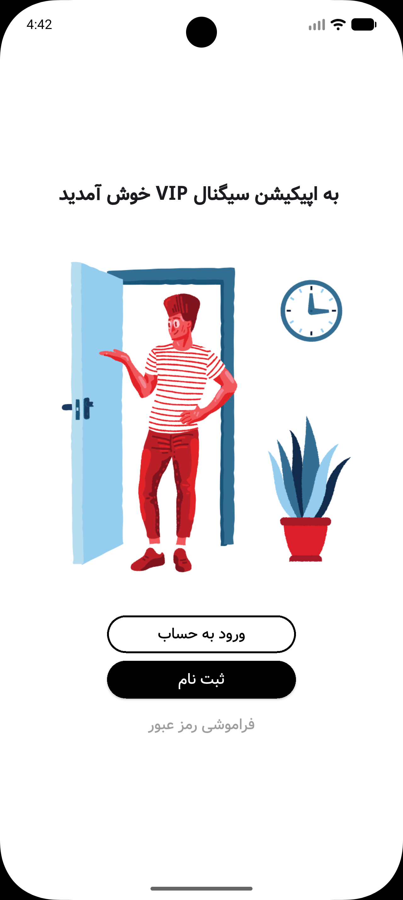

<div dir="rtl" align="right">

[English](README.md) | [فارسی](README.fa.md)

# سیگنال VIP

یک نمونهٔ رابط کاربری با Flutter برای نمایش اخبار رمزارزها و سیگنال‌های معاملاتی نمونه، با متن فارسی.


[](LICENSE)

برنامه با صفحهٔ خوش‌آمدگویی شروع می‌شود و از آنجا می‌توان به فهرست سیگنال‌ها رفت. هر کارت، تصویر نمودار و قیمت‌های نمونهٔ خرید و فروش را نشان می‌دهد. متن رابط فارسی است و از فونت Vazir استفاده می‌کند. این پروژه فعلاً برای پیاده‌سازی رابط کاربری است؛ سرویس معاملاتی یا کلاینتی با احراز هویت واقعی نیست.

## تصاویر برنامه

| صفحهٔ خوش‌آمدگویی | فهرست سیگنال‌ها | ادامهٔ فهرست سیگنال‌ها |
| :---: | :---: | :---: |
|  |  |  |

این تصاویر از قبل در پوشهٔ `assets/screenshots/` موجودند. پرانتزهای نام فایل‌های فهرست سیگنال‌ها فقط در لینک‌های گالری URL-encode شده‌اند و نام فایل‌های اصلی تغییر نکرده است. تصاویر گالری برای مستندات هستند و نیازی نیست به فهرست assets برنامه در Flutter اضافه شوند.

## امکانات اصلی

- صفحهٔ خوش‌آمدگویی فارسی، همراه با تصویر و دکمه‌های ورود، ثبت‌نام و بازیابی رمز عبور.
- فهرست قابل اسکرول با چهار سیگنال نمونه: SafeMoon، ‏Alchemy Pay (ACH)، ‏Cosmos (ATOM) و Ripple (XRP).
- تابع مشترک برای ساخت کارت سیگنال، شامل تصویر محلی نمودار، عنوان، قیمت خرید سبز، قیمت فروش قرمز و خط جداکننده.
- جابه‌جایی بین صفحه‌ها با `Navigator` و `MaterialPageRoute` خود Flutter.
- امکان برگشت و دکمهٔ خروج که کاربر را به صفحهٔ قبلی برمی‌گرداند.
- استفاده از فونت Vazir و تصاویر همراه پروژه؛ در پیاده‌سازی فعلی هیچ درخواستی برای دریافت داده از سرور وجود ندارد.

### بخش‌هایی که هنوز پیاده‌سازی نشده‌اند

دکمه‌های ورود و ثبت‌نام هر دو مستقیماً همان فهرست سیگنال‌ها را باز می‌کنند. هنوز فیلد دریافت اطلاعات ورود، ساخت حساب، بررسی احراز هویت یا ذخیرهٔ نشست کاربر وجود ندارد. صفحهٔ بازیابی رمز عبور فعلاً فقط یک متن نشان می‌دهد و دکمهٔ خروج هم صرفاً مسیر فعلی را می‌بندد؛ خروج از حساب در سمت سرور انجام نمی‌شود.

عنوان، تاریخ و قیمت سیگنال‌ها در `blog_page.dart` به‌صورت ثابت نوشته شده‌اند. نمودارها فایل تصویر هستند، نه نمودار زنده یا تعاملی. API داده‌های بازار، لایهٔ شبکه، ذخیره‌سازی محلی و اجرای معامله در پروژه وجود ندارد. قیمت‌های نمایش‌داده‌شده صرفاً دادهٔ نمایشی هستند و نباید قیمت فعلی بازار یا توصیهٔ سرمایه‌گذاری در نظر گرفته شوند.

متن رابط فارسی است، اما جهت RTL در سطح برنامه و زیرساخت بومی‌سازی هنوز به‌صورت صریح تنظیم نشده‌اند.

## تکنولوژی‌ها و وابستگی‌ها

- **Flutter SDK:** ویجت‌های Material، چیدمان، مسیریابی و Theme.
- **Dart:** محدودیت نسخهٔ SDK برابر با `^3.12.0` است؛ یعنی `>=3.12.0 <4.0.0`.
- **`cupertino_icons: ^1.0.8`:** پکیج آیکون‌های Cupertino که در `pubspec.yaml` تعریف شده است؛ صفحه‌های فعلی از آیکون‌های Material استفاده می‌کنند.
- **`flutter_lints: ^6.0.0`:** قواعد پیشنهادی lint که از طریق `analysis_options.yaml` فعال شده‌اند.
- **`flutter_test` (SDK):** ابزار تست به‌عنوان وابستگی توسعه تعریف شده است، اما هنوز پوشهٔ `test/` در پروژه وجود ندارد.
- **Vazir:** فونت محلی با نام `vazir` ثبت شده و از طریق Theme برنامه اعمال می‌شود.

نام پکیج `signal_vip` و نسخهٔ برنامه `1.0.0+1` است. انتشار در pub.dev با مقدار `publish_to: 'none'` غیرفعال شده است. توضیح داخل فایل manifest هنوز متن پیش‌فرض Flutter، یعنی `A new Flutter project.`، است.

پروژه پکیج جداگانه‌ای برای State Management، شبکه، ذخیره‌سازی یا تولید کد ندارد. در حال حاضر فقط پوشه‌های پلتفرم Android و وب در مخزن موجودند.

## معماری و ساختار پروژه

ساختار پروژه ساده و صفحه‌محور است و یک تابع مشترک برای رابط کاربری دارد. این ساختار بر پایهٔ Clean Architecture، ‏MVVM یا چیدمان feature-first سازمان‌دهی نشده است.

<div dir="ltr" align="left">

```text
lib/
├── main.dart                   # App entry point, theme, and initial screen
├── login_page.dart             # Welcome screen and navigation callbacks
├── blog_page.dart              # Signal feed and hard-coded sample content
├── password_recovery.dart      # Placeholder password recovery screen
└── custom_widgets/
    └── post_widget.dart        # getBlogPost() signal-card renderer

assets/
├── fonts/                      # Bundled Vazir font
├── images/                     # Welcome illustration and chart images
└── screenshots/                # README gallery captures
```

</div>

فایل `main.dart` نقطهٔ شروع برنامه و محل تنظیم Theme است. صفحهٔ خوش‌آمدگویی در `login_page.dart`، فهرست و داده‌های نمونه در `blog_page.dart` و صفحهٔ موقت بازیابی رمز عبور در `password_recovery.dart` قرار دارند. تابع ساخت کارت‌ها هم در `custom_widgets/post_widget.dart` است. پوشه‌های assets به‌ترتیب فونت، تصاویر رابط و نمودارها، و اسکرین‌شات‌های README را نگه می‌دارند.

کلاس‌های `Application`، ‏`LoginPage`، ‏`BlogScreen` و `PasswordRecovery` همگی از نوع `StatelessWidget` هستند. فهرست سیگنال‌ها کارت‌های نمونه را مستقیماً می‌سازد و تابع `getBlogPost()` چیدمان مشترک آن‌ها را برمی‌گرداند. مدل، Repository، سرویس، ساختار BLoC/Provider/Riverpod یا state قابل تغییر در سطح برنامه وجود ندارد. مسیریابی با `Navigator.push` و `Navigator.pop` انجام می‌شود.

## راه‌اندازی و اجرا

### ۱. آماده‌سازی ابزارها

نسخه‌ای از Flutter را نصب کنید که Dart SDK همراه آن شرط `>=3.12.0 <4.0.0` را داشته باشد و مسیر Flutter را به `PATH` اضافه کنید. برای Android به Android Studio، ‏Android SDK و یک شبیه‌ساز یا دستگاه با USB debugging فعال نیاز دارید. تنظیمات ساخت Android، نسخهٔ هدف Java/Kotlin را ۱۷ قرار داده‌اند؛ JDK سازگار با ابزارهای Gradle و Android همین پروژه را استفاده کنید. برای اجرای نسخهٔ وب هم Chrome لازم است.

وضعیت ابزارها و نسخهٔ SDK را بررسی کنید:

<div dir="ltr" align="left">

```bash
flutter --version
flutter doctor
```

</div>

پیش از اجرا، خطاهای ابزارهای مربوط به پلتفرم انتخابی را برطرف کنید.

### ۲. دریافت پروژه

<div dir="ltr" align="left">

```bash
git clone https://github.com/mehrshadkhv/Signal-vip.git
cd Signal-vip
```

</div>

اگر پروژه را از قبل دارید، ترمینال را در پوشه‌ای باز کنید که فایل `pubspec.yaml` داخل آن قرار دارد.

### ۳. نصب وابستگی‌ها

<div dir="ltr" align="left">

```bash
flutter pub get
```

</div>

پکیج `build_runner` یا ابزار دیگری برای تولید کد تعریف نشده است؛ بنابراین مرحلهٔ code generation لازم نیست. تصاویر و فونت برنامه از قبل در `pubspec.yaml` تنظیم شده‌اند.

### ۴. اجرای برنامه

شبیه‌ساز Android را اجرا کنید یا دستگاه را وصل کنید. سپس فهرست دستگاه‌ها را ببینید و برنامه را اجرا کنید:

<div dir="ltr" align="left">

```bash
flutter devices
flutter run
```

</div>

اگر چند دستگاه یا پلتفرم در دسترس است، دستگاه Android را مشخص کنید:

<div dir="ltr" align="left">

```bash
flutter run -d <device-id>
```

</div>

به‌جای `<device-id>`، شناسه‌ای از خروجی `flutter devices` را قرار دهید؛ علامت‌های زاویه‌دار را ننویسید. برای اجرای نسخهٔ وب موجود در پروژه:

<div dir="ltr" align="left">

```bash
flutter run -d chrome
```

</div>

### ۵. بررسی کد

<div dir="ltr" align="left">

```bash
flutter analyze
```

</div>

هنوز تست خودکاری در مخزن وجود ندارد، ولی وابستگی `flutter_test` برای اضافه کردن تست در دسترس است.

## مجوز

پروژه با [مجوز MIT](LICENSE) منتشر شده است. حق نشر © ۲۰۲۶ متعلق به Mehrshad Khodavirdizadeh است.

</div>
